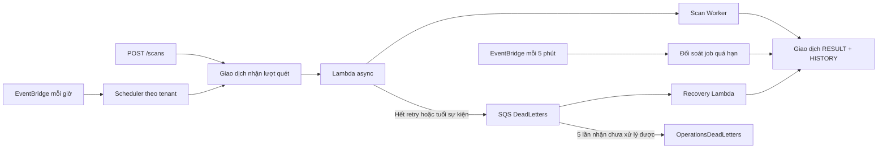

# Task 8 — lịch quét và phục hồi lỗi

Nguồn yêu cầu: báo cáo Nhóm 9, trang 17, Task 8 của Phạm Sỹ Đức và kế hoạch triển khai người dùng đã chốt ngày 26/10/2026. Task này điều phối chín loại tài nguyên hiện có; không mở rộng collector/rule hoặc dashboard. **Implementation và kiểm thử local được bàn giao ở đây; nghiệm thu AWS còn thiếu phiên AWS, stack kiểm thử và hai user thật. Chưa kết luận Task 8 hoàn tất trên AWS.**

## Luồng và hợp đồng

SQS là failure destination của Lambda async. Retry và sự kiện giao trùng có thể xảy ra ngay cả khi một lần xử lý đã thành công; worker và recovery phải idempotent. Xem [AWS async error handling](https://docs.aws.amazon.com/lambda/latest/dg/invocation-async-error-handling.html).

| Hạng mục | Hợp đồng |
|---|---|
| Lịch | EventBridge `rate(1 hour)`; `interval_hours` 1–24, mặc định 6; quét thủ công cũng cập nhật `last_queued` |
| API | `POST /scans` không body; 202 + `scan_id` khi nhận; 409 khi có lượt hoạt động; 429 trong cooldown 900 giây sau khi hết lượt hoạt động |
| Deadline | 900 giây từ lúc tạo marker, không được kéo dài bởi retry |
| Worker | Timeout 300 giây; lease tối đa 330 giây và không vượt deadline; token mới cho từng lần nhận lease |
| Lambda async | Tối đa 2 retry, tuổi sự kiện tối đa 600 giây; có thể hết tuổi trước khi dùng đủ retry |
| Khóa tenant | `LOCK` chứa scan ID, connection version, danh sách region và hạn deadline + 30 giây; chỉ xóa sớm khi mọi region của đúng lượt đó đã kết thúc |
| Trạng thái | `QUEUED`, `RUNNING`, `SUCCEEDED`, `PARTIAL`, `FAILED`, `TIMED_OUT` |
| Time budget | Kiểm tra trước STS và trước từng request/trang collector; còn dưới 60 giây thì không bắt đầu đọc AWS tiếp |
| SDK collector/STS | Standard, tổng tối đa 3 attempts/request; connect 3 giây, read 10 giây |
| Lưu trữ | RESULT cuối và HISTORY có TTL 30 ngày; hai queue giữ 14 ngày; DynamoDB TTL xóa bất đồng bộ |
| Tương thích | Giữ route và `results`; thêm `trigger`, `created_at`, `deadline_at`, `attempt_count`, `error_code` khi có |

`started_at` tiếp tục giữ thời điểm marker được tạo để tương thích dữ liệu cũ. `attempt_count` tăng khi nhận lease thành công; failure envelope có thể bổ sung số lần Lambda đã invoke, kể cả lỗi runtime trước khi vào worker. Hai con số không phải số request SDK.

## Giao dịch và chống ghi đè

`enqueue` nhận khóa tenant, kiểm tra connection/settings hiện tại và thời điểm đến hạn, tạo toàn bộ marker region và cập nhật `last_queued` trong một giao dịch. Chỉ sau commit mới invoke từng worker. Marker hoạt động quá hạn được kết thúc và lưu history trước khi được thay. Một marker còn hoạt động vẫn chặn enqueue ngay cả khi khóa đã hết hạn.

Worker nhận lease bằng giao dịch gồm Update marker và ConditionCheck profile. Điều kiện kiểm tra scan ID, connection version, region còn trong profile, trạng thái hoạt động và hạn lease. Job trùng còn lease sẽ lỗi để Lambda retry; job đã kết thúc hoặc thuộc connection cũ được bỏ qua. Mọi ghi kết quả hoặc giải phóng lease đều kiểm tra đúng run token. Lưu connection chỉ Update các trường connection, không ghi đè `last_queued`, settings hay notifications vừa đổi đồng thời.

`finish_scan` ghi RESULT và HISTORY trong một giao dịch, dùng history key cố định `HISTORY#<created_epoch>#<region>#<scan_id>`. Snapshot history loại bỏ `candidates` nội bộ. Kết quả/history cuối có thời điểm, region, scan/connection, TTL và lỗi chung đã làm sạch. Findings của history không đổi theo feedback hiện tại; metadata notification có thể được cập nhật sau commit.

Lỗi conditional xác nhận mất quyền sở hữu được bỏ qua. Transaction conflict, throttling, AccessDenied trên bảng và lỗi transport vẫn truyền ra để retry. Quyền giao dịch DynamoDB lấy theo từng thao tác, gồm `ConditionCheckItem` và `DeleteItem` cho khóa; xem [AWS transaction IAM](https://docs.aws.amazon.com/amazondynamodb/latest/developerguide/transaction-apis-iam.html).

Email chạy sau commit. Lỗi gửi email hoặc cập nhật metadata notification không làm mất snapshot và không khiến worker đọc lại inventory. Nếu cập nhật metadata thất bại, notification có thể còn `PENDING`; không có bộ retry email riêng trong Task 8. Hợp đồng SES/digest chi tiết thuộc Task 10.

## Phân loại lỗi và phục hồi

| Tình huống | Hành vi |
|---|---|
| STS bị từ chối / token không hợp lệ | FAILED, `ASSUME_ROLE_DENIED`, history + TTL; lỗi ghi DynamoDB vẫn phải retry |
| Một dịch vụ bị lỗi, thiếu metric hoặc hết time budget trong collection | PARTIAL, giữ bằng chứng hợp lệ của các dịch vụ/tài nguyên đã xử lý; thiếu dữ liệu không thành zero |
| Không đủ 60 giây trước khi bắt đầu STS | TIMED_OUT, `TIME_BUDGET`, không đọc account đích |
| Dispatch region bị lỗi | FAILED, `DISPATCH_FAILED`, có history; region khác tiếp tục; không kết thúc marker đã được worker claim |
| Lỗi hạ tầng cấp worker | Lambda async retry; lease được giải phóng sớm bằng đúng token khi có thể, nếu không sẽ hết hạn |
| OnFailure `RetriesExhausted` | Recovery lưu FAILED, `RETRIES_EXHAUSTED` |
| OnFailure `EventAgeExceeded` hoặc job đã quá deadline | Recovery lưu TIMED_OUT |
| Recovery gặp lease còn hiệu lực | Không ack record đó; SQS giao lại sau visibility timeout |
| Recovery message cũ/trùng, job đã kết thúc | Không ghi đè scan mới, không thêm history trùng |
| Envelope sai cấu trúc hoặc lỗi consumer | Trả `batchItemFailures`; sau 5 lần nhận chuyển DLQ vận hành |
| Tiến trình dừng sau admission, trước dispatch | Reconciler tự đóng marker quá hạn; không cần request API hoặc failure message |

Recovery timeout 30 giây; failure queue visibility 180 giây, batch 10, `ReportBatchItemFailures`. Thông số visibility theo [AWS hướng dẫn SQS/Lambda](https://docs.aws.amazon.com/AWSSimpleQueueService/latest/SQSDeveloperGuide/sqs-configure-lambda-function-trigger.html). Reconciler chạy mỗi 5 phút. Khi hạ tầng hoạt động bình thường, marker quá hạn được lưu ở lượt đối soát kế tiếp; API cũng suy ra TIMED_OUT từ deadline để tương thích khi consumer/đối soát bị chậm. Đây không phải cam kết SLA trong lúc AWS hoặc quyền truy cập đang lỗi.

Scheduler và reconciler có cả EventBridge delivery DLQ và Lambda async OnFailure vào `OperationsDeadLetters`. Recovery/reconciler không được assume role, gọi scanner hay đọc account đích. Alarm theo dõi Lambda `DestinationDeliveryFailures`, EventBridge lỗi gửi DLQ và số message đang chờ ở DLQ vận hành. Alarm hiện chỉ có trạng thái/metric; chưa cấu hình SNS/người nhận tự động.

## Ma trận tiêu chí và bằng chứng local

| Yêu cầu Task 8 | Test/bằng chứng | Lớp |
|---|---|---|
| Nhận scan nguyên tử; manual đụng lịch; stale profile | `test_admission_commits_lock_all_regions_and_clock_before_dispatch`, `test_admission_transaction_failure_creates_no_orphan_or_dispatch`, `test_stale_scheduler_profile_cannot_queue_after_reconnect_or_settings_change` trong [test_task8.py](tests/test_task8.py) | Moto/mock |
| Lịch trước/đúng/sau hạn, interval 1/24, pagination, profile hỏng và lỗi hạ tầng tenant | `test_scheduler_interval_boundaries_and_pagination`, `test_scheduler_isolates_invalid_profile_before_valid_tenant`, `test_scheduler_infrastructure_failure_processes_remaining_tenants_then_retries` | Moto/mock |
| Không mở lại trạng thái cuối; đúng lease/token | `test_terminal_race_cannot_reopen_result_or_read_target`, `test_duplicate_active_lease_retries_and_exact_expiry_can_be_claimed`, `test_old_run_token_cannot_finalize_or_release_new_worker` | Moto/mock |
| RESULT/history cùng commit; retry không mất/trùng history | `test_result_and_history_transaction_retries_without_losing_history`, `test_infrastructure_denied_is_retried_instead_of_claimed_success`, `test_throttled_read_after_claim_releases_token_for_retry` | Moto/mock |
| STS denial đủ metadata; email không phá snapshot | `test_revoked_role_has_atomic_history_timestamps_and_retention`, `test_email_failure_keeps_committed_history_and_does_not_rescan` | Moto/mock |
| Connection/tenant isolation, cập nhật profile đồng thời | `test_connection_race_at_claim_never_reads_the_old_account`, `test_reconnect_during_scan_rejects_old_result_and_preserves_new_result`, `test_connection_save_preserves_concurrently_queued_clock_and_settings`, API suites | Moto/mock |
| Failure envelope hợp lệ/trùng/cũ/sai; batch và lease race | Các `test_failure_*`, `test_recovery_*` trong [test_task8.py](tests/test_task8.py) | Moto/mock |
| Đối soát job chưa dispatch, deadline và snapshot trước thay thế | `test_reconciler_finalizes_undispatched_job_once_with_pagination`, `test_expired_marker_is_archived_before_replacement`, `test_deadline_worker_stops_before_assume_role_and_terminal_replay_is_safe` | Moto/mock |
| Guard inventory/metric/S3 và SDK attempts | [test_collector_budget.py](tests/test_collector_budget.py), [test_workflows.py](tests/test_workflows.py) | Mock |
| Queue, IAM, delivery/async lỗi, alarm | [test_task8_template.py](tests/test_task8_template.py), cfn-lint, SAM transform offline và kiểm tra dependency cycle | Static/offline |
| Chín collector, API/history cũ, polling/trạng thái desktop/mobile | Backend hiện có, [ui_smoke.py](tests/ui_smoke.py), [ui_redesign.py](tests/ui_redesign.py) | Moto/mock, browser demo/fixture |
| Tick, retry, timeout, SQS/DLQ và hai user thật | [Harness/runbook AWS](TASK8-AWS.md) | CHƯA CHẠY AWS |

Bốn regression đầu được chạy trước sửa: hai FAIL và hai ERROR. Sau sửa, tất cả đạt. Số test cuối, lệnh và giới hạn môi trường được ghi trong [VALIDATION.md](VALIDATION.md); không dùng số test lịch sử thay cho kết quả của source hiện tại.

## Runbook timeout / DLQ

1. Xác nhận account, region, stack và revision/code hash qua Outputs; dùng stack kiểm thử `cloud-resource-guardian-task8-test` cho các lỗi chủ động. Không dùng stack đang phục vụ người dùng để gây timeout hoặc thay handler.
2. Lấy scan ID từ API trạng thái/history. Đối chiếu RESULT, HISTORY, `connection_version`, `deadline_at`, `attempt_count`, lease và log có `scan_id`/region/trigger/error_code. Không đưa profile, token, ExternalId hoặc nguyên failure envelope vào log/bằng chứng chia sẻ.
3. Nếu RESULT đã kết thúc và history tồn tại, message trùng/cũ không được chạy lại tài nguyên. Nếu lease còn hiệu lực, chờ hết lease và consumer giao lại; không sửa token hoặc xóa khóa đang có worker giữ.
4. Nếu API hiển thị TIMED_OUT nhưng RESULT còn hoạt động sau lượt đối soát kế tiếp, kiểm tra ReconcileFunction errors, IAM và hai đường lỗi delivery/async. Job chưa dispatch không tự được phát lại; đối soát chỉ lưu trạng thái cuối.
5. Kiểm tra `DeadLetters` và `OperationsDeadLetters` từ Outputs. Queue thứ nhất có consumer; queue thứ hai cần người vận hành đối chiếu lỗi cấu trúc/quyền/hạ tầng. Nếu `DestinationDeliveryFailures` hoặc EventBridge alarm bật, kiểm tra quyền SendMessage và queue policy trước, vì message có thể chưa vào queue.
6. Khôi phục quyền/cấu hình rồi đối chiếu lại trạng thái/history. Chỉ redrive message còn liên quan sau khi xác định lỗi consumer đã sửa; redrive vẫn giữ scan ID cũ và không được mở trạng thái kết thúc. Không purge/xóa message trước khi lưu bằng chứng đã làm sạch và xác nhận xử lý.
7. Yêu cầu scan mới bằng API sau khi lượt cũ kết thúc và hết cooldown. Scan mới có ID mới; không tự replay worker cũ để thử quét lại. Giữ message vận hành cần điều tra theo retention 14 ngày.

Đóng Task 8 chỉ sau khi các ca AWS bắt buộc trong kế hoạch đạt, wrapper gây lỗi được loại bỏ, mọi function khớp artifact cuối và smoke cuối đạt. Inventory rỗng chứng minh luồng điều phối; rule trên tài nguyên thật vẫn cần nghiệm thu riêng.
